# T-90M for Gunner, HEAT, PC!

A Russian **T-90M "Proryv"** for GHPC, as its own unit. Relikt ERA, the Sosna-U gunner's sight with a target tracker,
the commander's PK PAN panorama with a remote Kord on top of it, TShU-1-2M, the Invar-M missile and the 3OF82 Telnik
air-burst round.

I made this mod for myself first, but you're welcome to use it too. It's still being worked on, so a few things can
change between versions. It's a separate mod from my [T-90A](https://github.com/marsattackk/GHPC-T90A),
[T-80UM2](https://github.com/marsattackk/GHPC-T80UM2) and [Leclerc SXXI](https://github.com/marsattackk/GHPC-LeclercSXXI),
and they all work fine installed together.

<p align="center">
  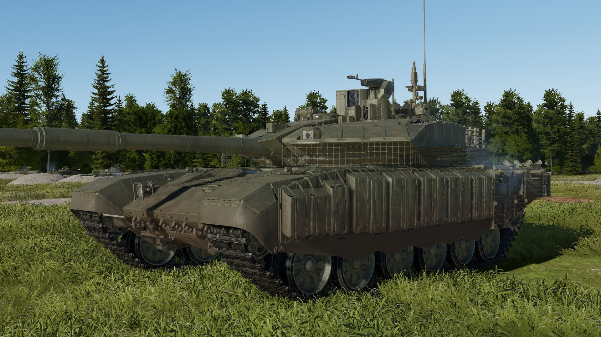
  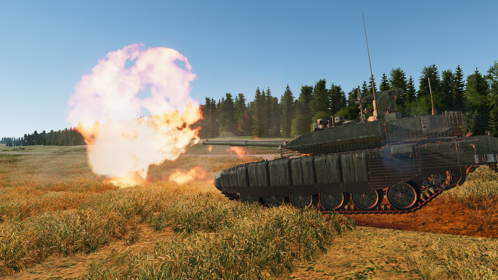
</p>

## Installing it

1. Get [MelonLoader](https://github.com/LavaGang/MelonLoader/releases) (0.7.3 or newer) into GHPC if you don't have it
   already. No other mod is needed.
2. Download `T90M_<version>.zip` from [Releases](../../releases/latest).
3. Copy the `Mods` folder from the zip into the game folder, the one with `GHPC.exe` in it (Steam: right-click GHPC >
   Manage > Browse local files). You should end up with:
   ```
   Mods\T90M.dll
   Mods\T90M\t90m
   ```
4. Start the game. The T-90M is in **Instant Action** (unit "T-90M"), in the **Soviet campaign** roster, and in the
   "Showcase of most playable vehicles" mission. In the campaign it's about half as common as the T-90A and turns up
   after two missions.

To remove it, delete `Mods\T90M.dll` and the `Mods\T90M` folder. That's safe mid-campaign too, because the campaign
save doesn't keep a list of units.

Once per game start the mod asks GitHub whether there's a newer release. If there is, you get one line with a link in
the MelonLoader console and that's it. Offline it stays quiet. `Check for updates` turns it off.

## Overview

The T-90M (Object 188M) is what the T-90A turned into. Uralvagonzavod started on it in the early 2010s as "Proryv-3",
taking what worked on the T-90AM and the export T-90MS. It was first shown at Army-2018 and reached the army in spring
2020. Most of them aren't new tanks at all but T-90As taken out of storage and rebuilt.

In GHPC it's built on the game's T-72M1, like my T-90A, so the hull, the running gear, the autoloader and the 4.2 km/h
reverse are all the same. Over the T-90A it gets Relikt, nets and slats, an armoured box on the turret rear with ten
rounds in it, a far better gunner's sight, a turret that traverses at 40°/s instead of 24, and a commander who can
actually hunt with the panorama.

It isn't better everywhere. Under the ERA it has the T-90A's armour, and it has no IR jammer, a much slower Kord and
two rounds fewer. From the side and above it's still a T-72. The full comparison with the T-90A and a bit more history
are in [docs/details.md](docs/details.md).

## Target alerts

The crew are the T-80B's, Russian voices and all, and they call targets on the hull azimuth compass. "At 30" is
straight ahead of the hull, 15 is straight left and 45 straight right. The official
[T-80B gunnery guide](https://gunnerheatpc.com/news/articles/gunnery-guide-t-80b) explains the system properly.

## Sosna-U sight and Kalina fire control

<p align="center">
  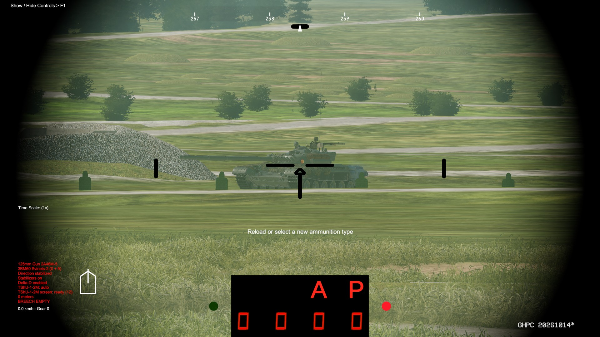
  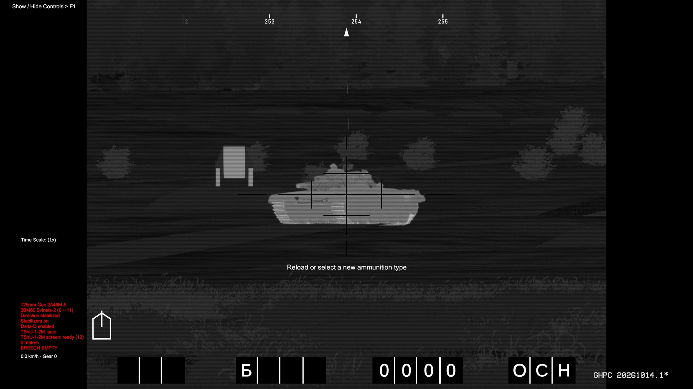
</p>

The Sosna-U has the day and thermal channels in one head, stabilised on its own, with the Kalina fire control behind
it. You get a laser rangefinder from 300 m to 10 km, automatic superelevation and lead, delta-D, cant correction, 4x and
12x by day, and a fire gate that waits for the gun to be laid. The head can look 7.5° either side of the gun and from
-10° to +30° up and down. You aim the sight and the turret catches up.

**No manual mode.** The T-80B and my T-90A drop into manual when you set the range by hand. The Kalina doesn't. Set it
by hand (default LCtrl + mouse wheel, or PgUp / PgDn) and the computer just takes your range, with lead and
superelevation still on. Lase (default E) whenever you can, though.

**Lead.** The computer takes the last second of your traverse and works the lead out from it, sideways only. Keep the
tip of the aiming mark on the target, matching its speed, for a full second before you fire. It won't lead by more than
7.5°, the head's own travel, so a very fast crosser close in can outrun it.

**Firing when laid.** After a lase the gun won't fire until it has actually climbed to the elevation the computer set,
like the real firing-permission circuit. On a long shot that's a short pause. With `Fire only when the gun is laid` off
it fires when you like, but a shot while the gun's still climbing falls short.

**The block under the picture.** The round (AP, К for HEAT, HF for both HE rounds, GA for the missile, MG) and the
range, with the ready lamp on the left and the laser lamp on the right. The laser lamp goes dark for two seconds after
each lase while it recharges. Square brackets come up in the block while the tracker has a target.

**The ПДТ.** If the Sosna-U gets knocked out, there's the ПДТ, the back-up TV sight left of the gun. It's black and
white and laid along the bore, with a stadiametric scale and no lead. Judge the range on the scale and set it by hand.

## Night fighting

The thermal channel (default T) comes up on a flat monitor, grey, a 4:3 picture with black bars either side. It has
three fields: 9 × 6.75° for searching, 3 × 2.25° for shooting, and 1.5 × 1.12° with the electronic zoom on top. The
narrow and zoomed fields have the cross and a readout row under it (ready, round in Cyrillic, range, mode). The wide
field has no readout, so don't shoot from it.

The fire control works through the thermal the same as through the day sight. Like any thermal it sees through smoke
and the laser doesn't. A range taken into a cloud is the cloud's, so look again before you trust it.

## The target tracker

The Sosna-U has an automatic target tracker, and it's what makes this tank different to fight in. Hold the cross on a
tank in the narrow thermal field until the ready frame comes up round it, then lase (with APFSDS, HEAT or the missile
loaded) or press the tracker key, middle mouse button by default. From then on the sight stays on the target and the
computer gets the lead from it. You can still nudge the aim inside the frame.

- It follows the target's path, not every bump, so a tank rocking over rough ground doesn't shake the sight.
- Lose it behind a wall or smoke and it carries on where the target was heading for up to 6 seconds.
- The key again, a shot from the gun, a field change or aiming away past the frame drops it. So does a polarity
  change, the stabiliser being off or the fire control being knocked out.
- Firing the Invar-M doesn't drop it. The launch flash makes it coast for half a second and then it carries on.

The ready frame comes up on a tank out to about 4 km. The real tracker only works off the thermal picture, but there's a
setting to let the day channel lock too. The panorama has a tracker of its own.

## The commander's PK PAN and the Kord

<p align="center">
  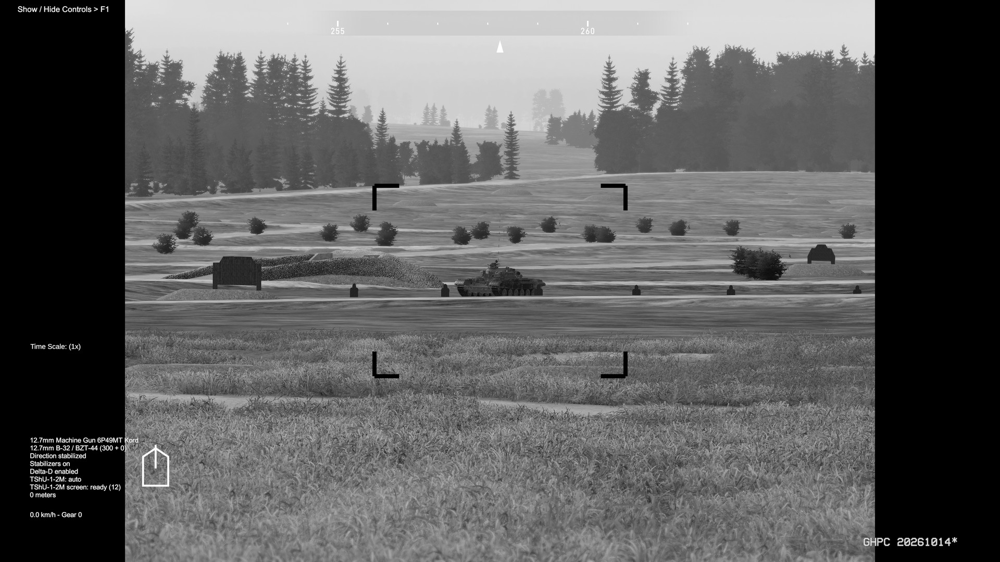
  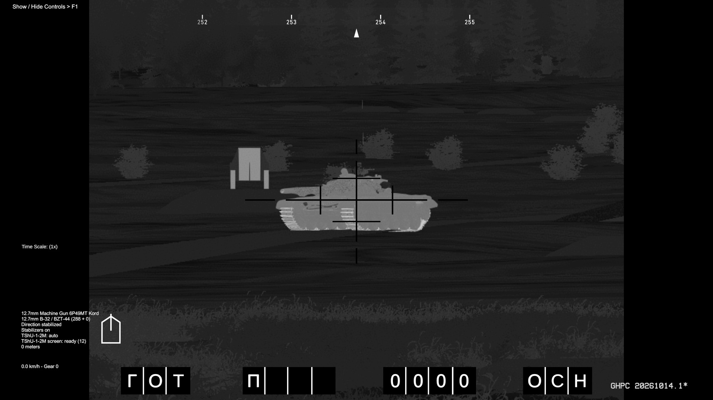
</p>

The commander has the PK PAN panorama on the turret roof: a black-and-white TV channel 7.4° or 2.5° wide, the same
thermal fields as the Sosna-U, and a laser of its own good for 300 m to 7.5 km. It turns all the way round and looks
from -15° to +45°. A 12.7 mm Kord sits on top of it and goes where the panorama looks.

**Hunting.** Find something in the panorama and hold the game's **Aim Override** key, and the turret and gun swing onto
it. If you lased it from the panorama first, the gun takes that range too. Let go while the panorama's own tracker has
it locked and the gunner's tracker takes the target over, so the gun stays on it while you look for the next one.

**Dubl.** With the main gun selected, the panorama has a Dubl view as well, where the commander lays the main gun and
the coax himself. Lasing in Dubl locks the tracker with any round loaded. The fire gate works here too.

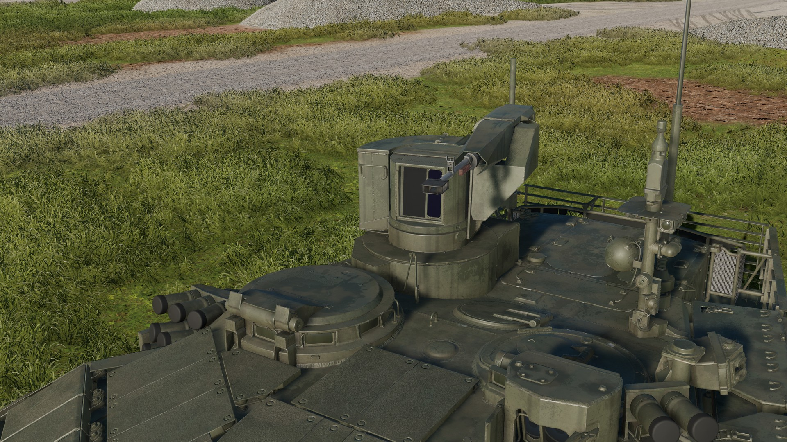

The Kord MT is fired from under armour with the hatch shut. One belt of 300, three armour-piercing incendiary to one
tracer, at 200 or 100 rounds a minute from the vehicle menu (Kord MT > Rate of fire). It traverses through 316°, and the
44° gap is over the gunner's sight head, where it simply won't fire. Elevation is -10° to +45°. You aim it through the
panorama only, not from the free-look head view. The spent cases go out forward on the right and lie on the tank until
it tilts or brakes hard enough to shake them off.

## TShU-1-2M

<p align="center">
  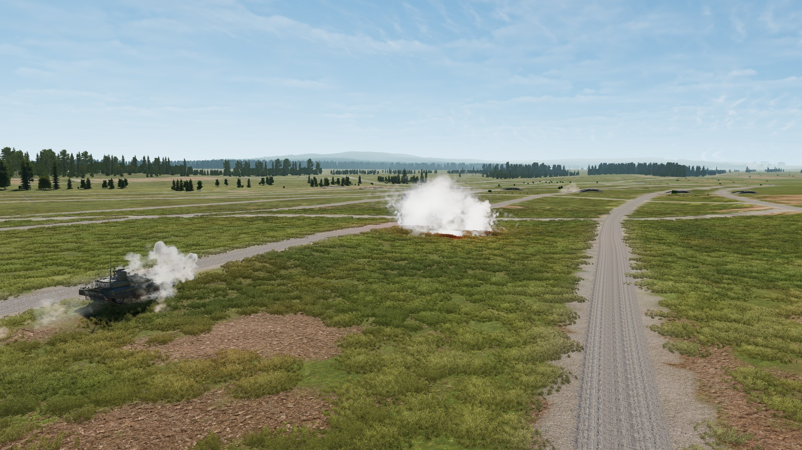
  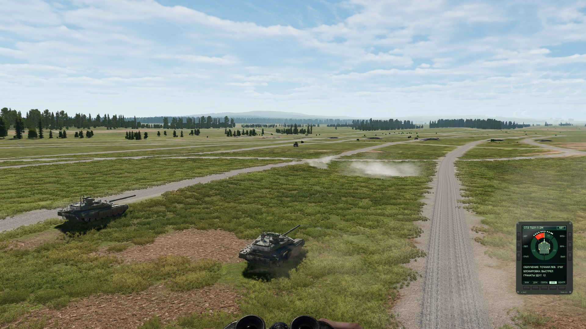
</p>

The screen half of the old Shtora, without the IR jammer. The real T-90M lost the jammer lamps too. It won't stop a
missile on its own, but it spoils the other side's aim.

- Get lased and a warning page comes up bottom right with a tone, showing the direction relative to the turret.
- Lased from in front of the turret, it fires a 3D17 grenade towards the laser by itself. The cloud builds in about 3 s
  and stands for about 20, and anyone lasing through it has to judge the range by eye.
- From the side or rear you only get the warning. **Turn to Laser** in the vehicle menu swings the turret round until a
  front head sees the laser, and if they're still lasing you the screen goes up from there.

The automatic screen holds off with a hatch open and for 15 s after your own main gun shot. In SEMI mode you fire the
screen yourself with the smoke key (default G) or from the vehicle menu.

AI T-90Ms have it too. Lase one from the front and it screens itself. Lase it from the side and the turret comes round
at you. The heads, the page and the rest are in [docs/screens.md](docs/screens.md).

## Armour protection

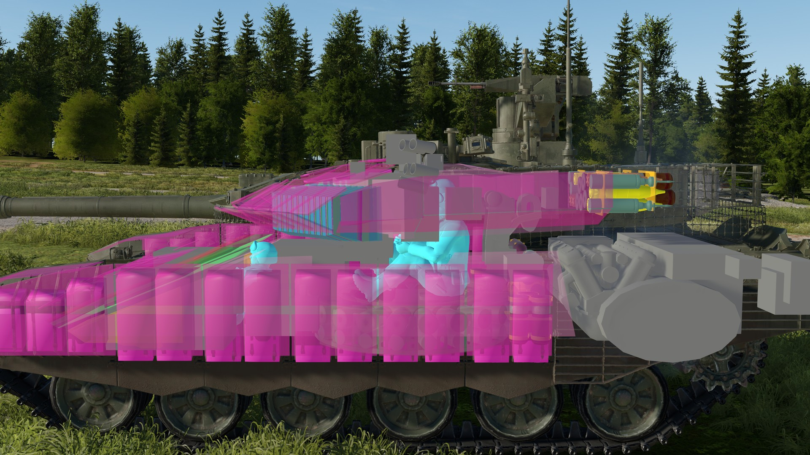

Under the ERA it's the T-90A's welded turret with the same cheek filling and the same glacis, so the numbers barely
move. With Relikt on top, the cheeks and the upper glacis stopped everything I fired at them, the Invar-M included. A
box only goes off for something worth it, so a PKT burst won't strip it.

Straight from the front, in mm of steel, without ERA:

| | Turret cheeks (vs APFSDS / vs HEAT) | Upper glacis (vs APFSDS / vs HEAT) |
|---|---|---|
| **T-90M** | **690 / 820** | **552 / 752** |
| T-90A (my other mod) | 690 / 819 | 549 / 748 |
| T-80B (vanilla) | 595 / 669 | 485 / 602 |
| M1IP (vanilla) | 516 / 999 | 348 / 361 |

Relikt adds about 250 vs APFSDS and 650 vs HEAT on the turret (600 on the hull). Nets on the turret sides and slats
round the back catch some HEAT grenades, but nothing tandem.

The weak spots are the strip down the middle of the glacis, which has no Relikt on it and lets a 3BM42 through, and the
mantlet beside the gun, where an Invar-M coming in at an angle gets into the turret. The bustle box on the rear is its
own compartment, so a round through it only finds the ammo in there. From the side and above it's a T-72.

How it's built, the sources, my test firing and every weak spot: [docs/armour.md](docs/armour.md).

## Ammunition

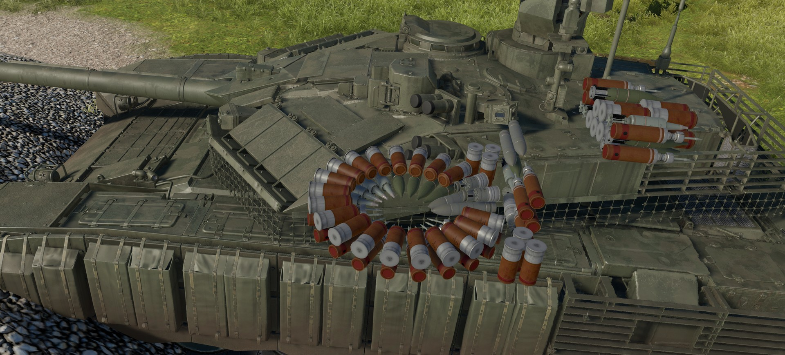

40 rounds: 22 in the carousel, 8 in the hull against the engine bulkhead and 10 in the bustle box. The places are from the
manual where it gives them; the mix of rounds is my own, no source gives a regulation one. The autoloader runs at the game's own T-72M1 speed, about 7.2 s a round.

| Round | Penetration |
|---|---|
| 3BM60 "Svinets-2" (default) | ~690 mm at the muzzle, 1660 m/s |
| 3BM42 "Mango" | ~580 mm at the muzzle, as on the T-90A |
| 9M119M1 "Invar-M" | 850 mm, tandem |
| 3OF82 "Telnik" | air-burst HE-Frag |
| 3BK18M HEAT, 3OF26 HE-Frag | the game's own rounds |

You pick 3BM60 or 3BM42 in the game's normal ammo menu.

**The Invar-M.** It rides a laser beam from the Sosna-U, so it goes where the cross is. Keep it on the target until it
hits. It arms at 100 m and takes about 17 s to reach 5 km, and the tandem warhead sets the ERA off before the main
charge gets there.

**The Telnik.** The Kalina sets the 3OF82's fuse from the lased range as the round goes into the breech. Three settings
in the vehicle menu under **3OF82 Telnik fuse**:

- **short of the target** (the default): bursts about 10 m in front of it
- **over the target**: the gun aims about 3 m higher and it bursts there
- **impact**: an ordinary HE round

It throws 450 fragments forward in a cone, which is pretty nasty for infantry in the open and does nothing to armour.
Lase first, then load, like the real drill. A round already in the breech keeps the range it was set to, and the menu
shows what that is. Under 300 m, or with no range at all, it goes off on impact.

**The bustle box.** Its 10 rounds sit behind blow-off lids. They come out slowly, 20 s each, and nothing refills the box
during a fight. If it cooks off, the lids blow and the fire vents upwards. The crew and the rest of the tank carry on.

## Settings

After the first start, `UserData\MelonPreferences.cfg` in the game folder has a `[T-90M]` section. Close the game
before editing it.

| Setting | Values | Default |
|---|---|---|
| `Enabled` | true / false | true |
| `Add to campaign roster` | true / false | true |
| `Campaign prevalence` | how common it is (1 = as common as a typical tank) | 0.25 |
| `Campaign unlock after missions` | number | 2 |
| `APFSDS` | `"3BM60"` / `"3BM42"`, where the game doesn't pick one itself | 3BM60 |
| `Fire only when the gun is laid` | true: after a lase the gun waits until it's at the elevation the computer set, from the sight and the panorama alike. false: fires any time, but a shot while it's still climbing falls short | true |
| `Target tracker` | false: no tracker in the sight or the panorama. Takes effect at once | true |
| `Target tracker key` | a Unity key name: `Mouse2` is the middle mouse button, or `Y`, `H`, `U`, `Mouse3`, `Mouse4`, or `None` to lock by lasing only. Pick one the game doesn't use | Mouse2 |
| `Target tracker from the day sight` | true: the day channel locks too, not just the narrow thermal field | false |
| `Weathered paint` | true / false (clean factory paint) | true |
| `TShU-1-2M` | false gives you the game's ordinary smoke salvo instead | true |
| `TShU-1-2M automatic screens` | false: the warning only, and you fire the screen from the vehicle menu or with the smoke key | true |
| `TShU-1-2M alarm tone` | false: the page only | true |
| `TShU-1-2M warning page` | false: no page, the tone only | true |
| `TShU-1-2M page always on screen` | true: on screen the whole time you're in the T-90M | false |
| `Kord spent cases` | false: no cases, the belt still feeds | true |
| `ERA destruction effects` | false: a Relikt box that's gone off still looks whole. true: it's gone with a blast, soot round it and the nets over it cut | true |
| `Armour preset` | `"game-scale"` / `"source-only"` (the lower open-source figures) | game-scale |
| `Check for updates` | true / false | true |

Most of them apply to T-90Ms spawned after the change. Leave the `ConfigVersion` line at the end alone. It's how the
mod tells which settings are still on an old default. The three campaign settings take effect at the next mission load,
no restart needed. A number saved with a decimal comma (`"0,3"`) is read fine too.

## Bugs and suggestions

I'm open to suggestions, fixes, better sources, pull requests, whatever you've got. If you know something about the real
T-90M that the mod gets wrong, tell me.

Found a bug? Open an [issue](../../issues) and attach `MelonLoader\Latest.log` from the game folder. The mod writes a
warning there whenever something didn't load right or a game update has broken one of its hooks. If the smoke key ever
fires nothing, it writes a line there saying why.

I only make and test it on the current Steam version of GHPC. A cracked copy or an old build might not load it at all
and I can't help with those, so make sure you're up to date before opening an issue.

## Maintaining it

The whole source is here so anyone can keep the mod working after a GHPC update without waiting for me. Pull requests
are welcome, and under the GPL a fork is fine too.

`T90M\` is the tank itself and `Common\` is the machinery it's built with, shared with my other ports. `Resources\`
holds the data built into the DLL: reticles, round models, the warning page, modules, the interior, armour values,
hatches, smoke points and the rest. The asset bundle (`Mods\T90M\t90m`: model, textures, armour meshes) isn't built
from this repo and neither is the Unity project behind it, so take it from the last release.

To build it you need the .NET SDK 6 or newer and GHPC with MelonLoader, because the build references the game's DLLs:

```
dotnet build -c Release -p:GameDir="<GHPC folder>\Bin"
```

The DLL lands in `bin\Release\T90M.dll`.

When a game update breaks something, start with this:

```
powershell -ExecutionPolicy Bypass -File tools\check-game.ps1 -GameDir "<GHPC folder>\Bin"
```

It looks up every hook the mod has in the new game's DLLs without starting the game and lists what's gone. A broken hook
only takes its own feature down, and `MelonLoader\Latest.log` names it. [docs/game-updates.md](docs/game-updates.md)
goes through the rest of the repair and what to test after it.

`dotnet test tests` runs everything that doesn't need the game (the reticles, the armour data, the settings, the
tracker's laying loop), and GitHub runs it on every push. `tools\check-settings.ps1` makes sure the settings table above
still matches the code, so a new setting needs a row there.

For the rest, [MAINTAINING.md](MAINTAINING.md) covers the layout, what happens when a T-90M spawns, the settings and
releasing, and [docs/bundle.md](docs/bundle.md) says what the code expects to find in the bundle.

This README follows `main`, which can be ahead of the latest release.

## Where the model comes from, and the licence

The 3D model and textures are War Thunder's T-90M, taken from War Thunder's game files. They belong to Gaijin
Entertainment and they're not covered by this repository's licence. The same goes for the armour shapes, cut from War
Thunder's damage model. Everything else (the armour values, the sights and their reticles, the fire control, the ammo,
the screen system, the interior) was built for GHPC from Russian sources.

The source code is under the [GNU General Public License v3.0](LICENSE).
