# T-90M for Gunner, HEAT, PC!

A Russian **T-90M "Proryv"** you can drive and fight in GHPC, as its own unit. Relikt ERA, the Sosna-U gunner's sight,
the commander's PK PAN panorama with the remote Kord on top of it, the TShU-1-2M screen system, 3BM60 and the Invar-M
missile, and the 3OF82 Telnik air-burst round.

It's a separate mod from my [T-90A](https://github.com/marsattackk/GHPC-T90A). You don't need the T-90A for it, and the
two work fine installed together.

<p align="center">
  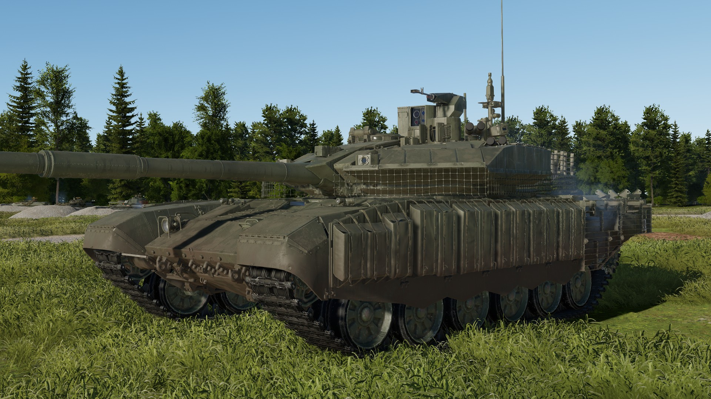
  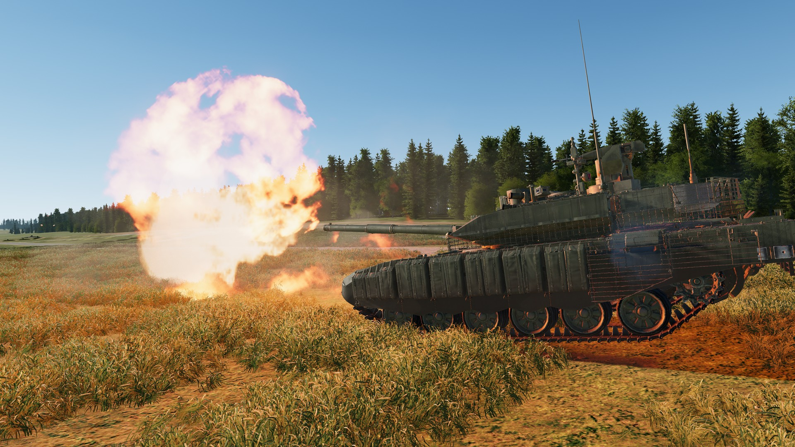
</p>

This README describes **version 0.1.0**. No other mod needed, just MelonLoader.

## Installing it

1. Get [MelonLoader](https://github.com/LavaGang/MelonLoader/releases) (0.7.3 or newer) into GHPC if you don't have it already.
2. Download `T90M_<version>.zip` from [Releases](../../releases/latest).
3. Copy the `Mods` folder from the zip into the game folder, the one with `GHPC.exe` in it (Steam: right-click GHPC >
   Manage > Browse local files). You should end up with:
   ```
   Mods\T90M.dll
   Mods\T90M\t90m
   ```
4. Start the game. The T-90M is in **Instant Action** (unit "T-90M"), in the **Soviet campaign** roster, and in the
   "Showcase of most playable vehicles" mission. In the campaign it's rarer than the T-90A, about half as common, and
   turns up after you've done 2 missions. You can turn that off or change it in the settings below.

Once per game start the mod asks GitHub whether there's a newer release, and if there is, it puts one line in the
MelonLoader console with a link to the releases page. Nothing in game, nothing gets downloaded or installed, and if
you're offline it just doesn't say anything. Set `Check for updates` to false (Settings, below) to turn it off.

To remove it, delete `Mods\T90M.dll` and the `Mods\T90M` folder. That's safe mid-campaign too, the game's campaign
save doesn't keep a list of units, so nothing in it points at the T-90M.

## From the T-90A to the T-90M

The T-90M "Proryv" (Object 188M) is what the T-90A turned into. Uralvagonzavod's design bureau started on it in the
early 2010s as "Proryv-3", taking what worked on the T-90AM and its export version the T-90MS ("Proryv-2") and fixing
what the army had found wrong with the older tanks. It was first shown at Army-2018 and the first ones reached the army
in spring 2020. A lot of them aren't new builds at all, most are T-90As taken out of storage and rebuilt, so underneath
it's basically the same tank. Same hull, running gear, autoloader and gearbox, still the T-72's 4.2 km/h reverse.

What changed, and what that means in game:

| | T-90A (my other mod) | T-90M (this one) |
|---|---|---|
| ERA | Kontakt-5, about +140 vs APFSDS / +550 vs HEAT | Relikt, about +250 / +650 (+600 on the hull), also in the rubber side screens |
| Other screens | none | nets on the turret, slats at the back |
| Turret | welded, every round inside the hull | the same welded front, plus an armoured bustle box on the rear with 10 rounds behind blow-off lids |
| Gunner's sight | 1G46 with the ESSA thermal on its own head, 1A45T fire control | Sosna-U, day and thermal in one head, Kalina fire control |
| Commander | TKN-4S day / night sight | PK PAN panorama, TV and thermal, can lay the gun and hand targets to the gunner |
| Remote Kord | on the cupola, 2 belts of 150, 625 rounds a minute, PZU-7 or TKN-4S | on top of the panorama, one belt of 300, 200 or 100 rounds a minute, panorama only |
| Defensive aids | Shtora-1: IR jammer, laser warning, aerosol screens | TShU-1-2M: laser warning and aerosol screens, no jammer |
| Engine | V-92S2, 1000 hp | V-92S2F, 1130 hp |
| Turret traverse | 24°/s | 40°/s |
| Main gun ammo | 42 rounds | 40: 22 in the carousel, 8 in the hull, 10 in the bustle box |
| Rounds | 3BM42 / 3BM60, 3BK18M, 3OF26, 9M119M Invar (700 mm) | the same shells plus the 3OF82 Telnik air-burst, and the 9M119M1 Invar-M (850 mm) |

Under the ERA the front armour hasn't changed. The T-90M kept the T-90A's welded turret with the same cheek filling and
the same glacis, which is why the numbers further down are pretty much the T-90A's (690 / 820 against 690 / 819 on the
cheeks). Where it's actually better protected is the ERA, the screens and getting 10 rounds out of the crew's way.
From the side and above it's still a T-72.

On the mod side, I built the T-90M after the T-90A, on the same groundwork. Everything I worked out on the T-90A
carries over: how the armour's put together, the ERA that doesn't go off for a PKT round, the Invar's tandem
precursor, the Kord's belt feed and spent cases, the paint, the T-80B's crew voices, and a fix on one goes into the
other. What's new is what's new on the real tank: the bustle box as its own compartment, the panorama with the Kord on
it, Relikt and the nets, TShU-1-2M and the Telnik round. It's still its own mod, neither needs the other.

## "It's a War Thunder model, does it even work in GHPC?"

Yes. The looks come from War Thunder, and so do the **shapes** of the armour plates, because War Thunder's damage model
is a pretty good map of where every plate, ERA box and screen sits on the real tank. What those plates are worth, and
everything else that decides what happens when a round hits, was built for GHPC with GHPC's own rules:

- **The armour values are mine, not War Thunder's.** Every plate got its thickness and strength from Russian sources
  (or, where nothing was published, the closest real equivalent, marked as a guess in my notes). War Thunder's numbers
  aren't used anywhere.
- **The inside works like a vanilla tank.** Crew, ammo and the autoloader carousel sit where they are in the real T-90M.
  The crew compartments are cut to the T-90M's own walls, so a round has to get through the armour before it counts as
  "inside". Drives, sights, the fire control computer, radio, the remote station and so on are damageable modules wired
  into the game's own systems, 25 of them, so knocking one out does what it does on a vanilla tank.
- **The turret bustle box is its own compartment.** 10 rounds live in the armoured box on the turret rear, behind
  blow-off lids. If it gets hit and cooks off, the lids go, the fire vents upwards and the crew and the rest of the tank
  carry on.

<p align="center">
  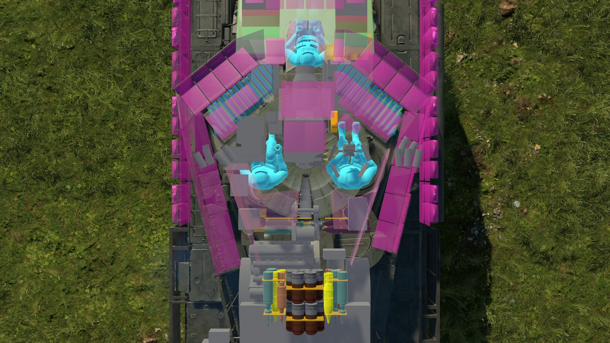
  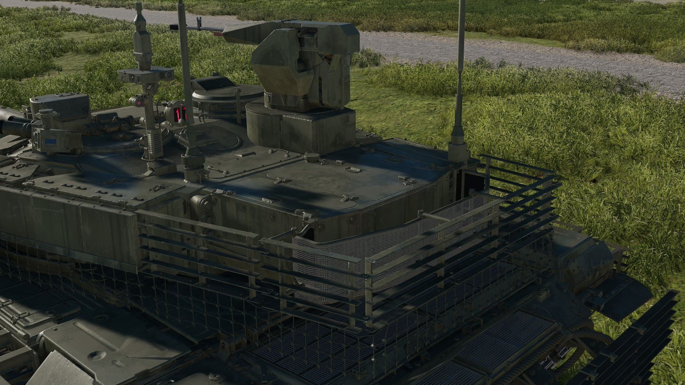
</p>

*Left: the x-ray from above, crew, the carousel under the turret and the racks. Right: the bustle box with its slat cage.*
- **The AI handles it like a vanilla tank.** AI T-90Ms pick their ammo, use the missile at range and fight at the same
  pace as the vanilla tanks, and it burns and cooks off like the T-72M1 next to it.
- **It fits in visually.** Glass and lenses use the game's own glass, the paint has the same finish as the vanilla
  tanks, the smoke tube caps pop off when a salvo fires, the turret nets and the antenna sway when you drive and fire,
  and at range it switches to a lighter model so it doesn't cost more to draw than it should.

## The armour, in numbers

Line-of-sight protection straight from the front, in mm of steel, **without ERA**, measured in game:

| | Turret cheeks (vs APFSDS / vs HEAT) | Upper glacis (vs APFSDS / vs HEAT) |
|---|---|---|
| **T-90M (this mod)** | **690 / 820** | **552 / 752** |

Relikt adds about **250** against APFSDS and **650** against HEAT on the turret (**600** on the hull) wherever a box is
hit. A box that's gone off is gone, a second hit on the same spot only meets the armour behind it.

A Relikt box only goes off for something that's worth it. Machine-gun and autocannon rounds up to 30 mm, and fragments
and spall, leave it whole, the same rule as on my T-90A. GHPC on its own sets ERA off on any hit, a PKT round included.
By default a box that has gone off is gone with a blast, the plate round it sooted and the nets over it cut. Set
`ERA destruction effects` to false and it still looks the same instead, it just doesn't protect anything any more.

- **Turret:** welded rolled steel at the model's own thickness, with the cheek filling set to match Russian estimates
  for the T-90M's turret front.
- **Upper glacis:** the T-72B obr. 1989 / T-90 stack, layer by layer: 60 mm steel, rubber and steel with an air gap,
  60 mm steel, a kevlar layer, 50 mm steel at 68°.
- **Hull:** 80 mm sides, 85 mm lower front plate, 40 mm rear, 20 mm belly, from Russian Wikipedia and Tankograd.
- **Screens:** the rubber side screens work like the game's own rubber skirts. The slat screens at the back work like
  the game's slat armour, and the net screens on the turret spoil a non-tandem HEAT grenade 55 % of the time and let the
  rest through untouched, which is how the people who make them describe it. Tandem rounds pass both.
- **Spall liners** inside the turret and hull, on the game's own liner material.

The numbers above are from the game's own armour probe. It's also been shot at properly: 552 rounds in game at 47 spots
all over the tank (3BM42, 3BK18M and the Invar-M, turret straight and turned 17°), next to a vanilla T-72M1 getting the
same, checking where every round stopped.

<p align="center">
  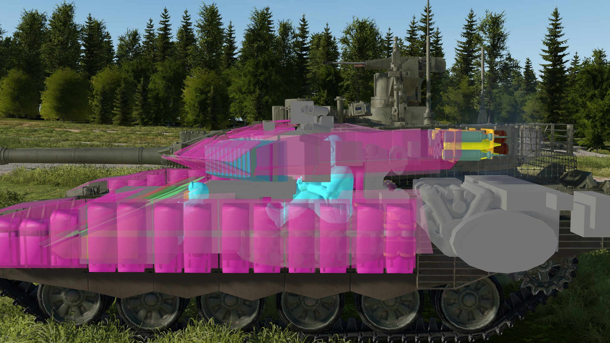
  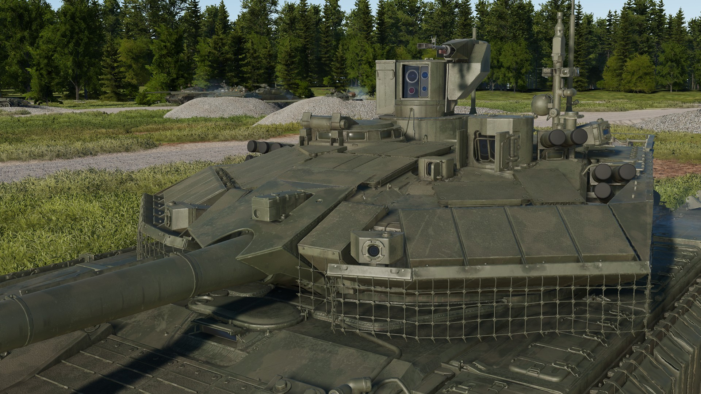
</p>

*Left: the hit x-ray from the side, Relikt in pink, the crew light blue, the modules grey. Right: the turret front with
its Relikt and the net screens.*

### Weak spots

From that live fire, straight from the front:

- **Turret cheeks** with their Relikt stop 3BM42 in the filling and 3BK18M in the Relikt. The Invar-M's precursor sets
  the Relikt off and its main charge gets through the filling, but the inner wall stops it about 50 mm short.
- **Upper glacis** with its Relikt stops everything I fired. The strip down its middle has no Relikt boxes on it, and
  there a 3BM42 gets through the glacis and stops at the hull floor, and the Invar-M reaches the cooling fan.
- **The gun mask** round the barrel: the barrel itself stops what hits it. The mantlet next to it is the usual weak
  spot, an Invar-M coming in at an angle can get through it into the turret.
- **The bustle box** on the turret rear is its own compartment. A round through its sides hits the stowed ammo in there
  and nothing else, the crew and the rest of the tank don't count it as inside.
- **From the side and above it's a T-72**, same as my T-90A.

## The sights

<p align="center">
  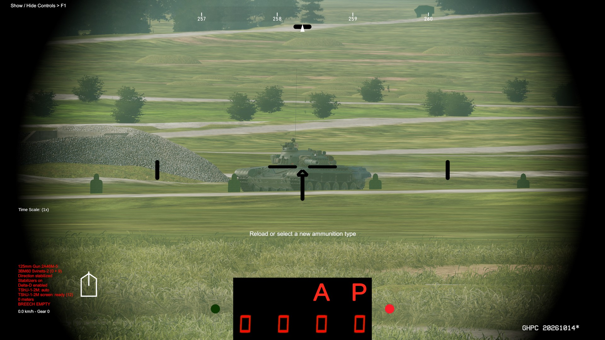
  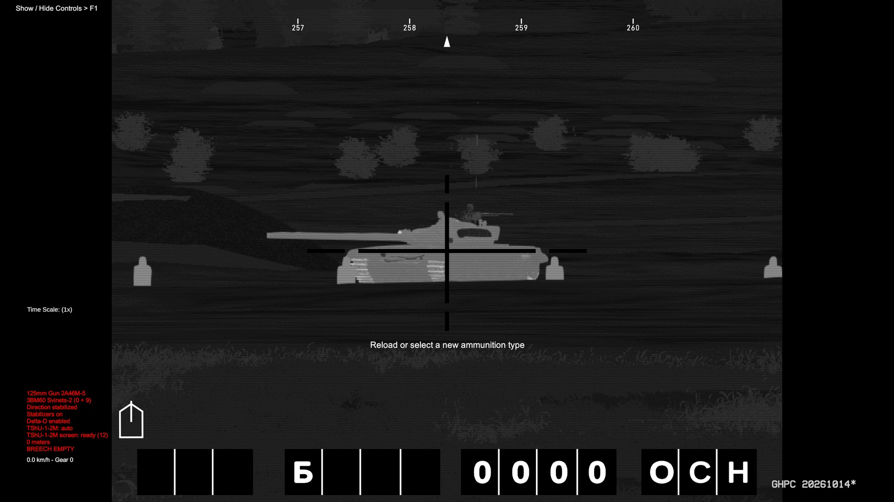
</p>
<p align="center">
  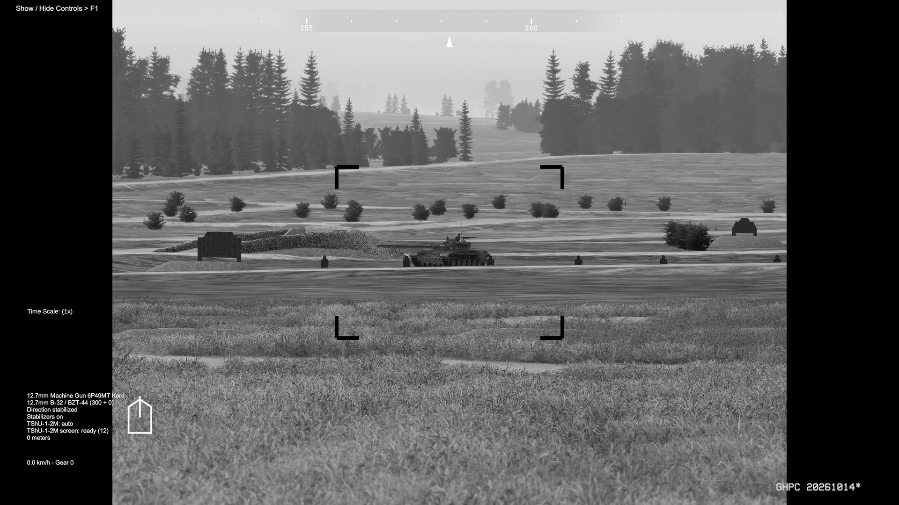
  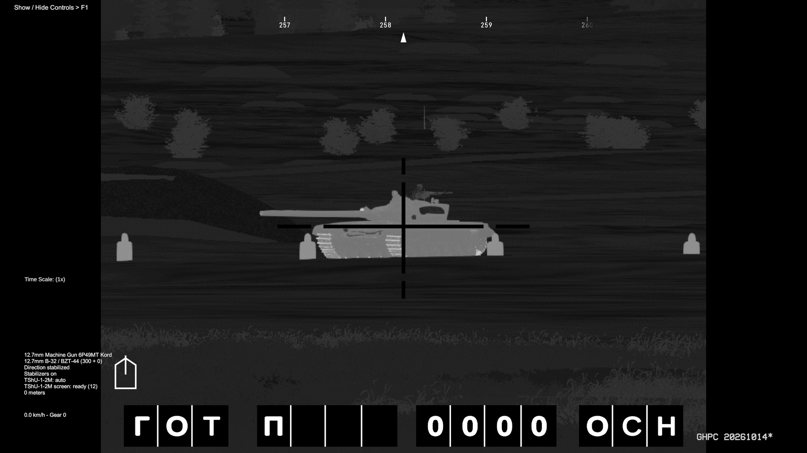
</p>

*Top: the gunner's Sosna-U by day and its thermal channel. Bottom: the commander's PK PAN, TV and thermal.*

- **Sosna-U gunner's sight + Kalina fire control:** day channel at 4x and 12x with the reticle from the manual's
  figure, thermal channel in three fields (9 × 6.75°, 3 × 2.25° and 1.5 × 1.12°) on the monitor at 768 x 575 with the
  scan lines of its CRT, laser rangefinder from 300 m to 10 km. Line of sight -10° / +30°, stabilised on its own. The
  readout under the picture shows the range, the round and the ready lamps.
- **Commander's PK PAN panorama:** TV channel (7.4° and 2.5° wide, black and white) and thermal (the same three fields),
  its own laser rangefinder, on a flat monitor. It turns all round on the turret roof, and the Kord turns with it.
- **Dubl:** the commander can lay the main gun and the coax from the panorama.
- **Hunter-killer:** hold the game's Aim Override key in the panorama and the turret and gun slew onto what you're
  looking at, so the gunner can take it from there.
- **PDT back-up sight:** left of the gun, laid along the bore, with a stadiametric scale and the range set by hand. For
  when the Sosna-U's been knocked out.

## The remote Kord

- 12.7 mm Kord MT, **300 rounds** in one belt, reloaded under armour. 200 rounds a minute, or 100 on the switch (vehicle
  menu > Kord MT > Rate of fire).
- Aimed only through the panorama, hatch closed. 316° of traverse, -10° / +45°. The 44° it can't fire through is over
  the gunner's sight head.
- Drives, panorama and gun can be knocked out separately.
- You don't get the Kord from the commander's head view (the one with the binoculars), only through the panorama.
- Firing, the belt feeds into the gun round by round and the spent cases go out forward on the right. They land on the
  tank and stay there until it tilts or brakes hard enough to shake them off. Don't want them? Set `Kord spent cases`
  to false.

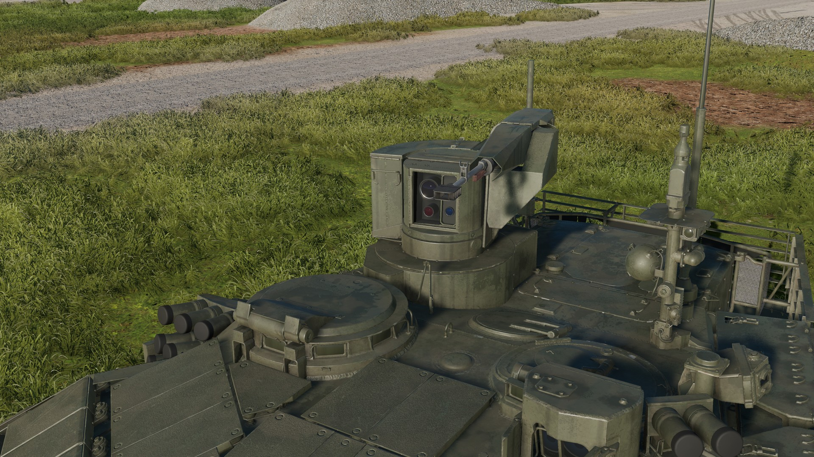

## TShU-1-2M screen system

The T-90M has the screen half of the old Shtora and no IR jammer (the jammer lamps are gone on the real tank too):

- **Laser warning** all round: two precise heads on the turret front (45° either side) and two coarse ones on the sides.
  Get lased and a warning page comes up bottom right with a tone, showing which way it came from and what the system
  did. The page is my take on the commander's touch screen, the real one's layout isn't published. In the thermal
  sight, the PDT and the panorama it goes bigger in the black bar to the right of the picture.
- **Automatic 3D17 aerosol screens** from the smoke tubes towards a laser in the front sector. An AI tank whose laser is
  blocked by the screen has to judge the range by eye.
- **From the vehicle menu** (TShU-1-2M): fire a screen where the gun points, or turn the turret to a laser that came from
  the side or rear.

Everything can be switched off or toned down in the settings.

## 3OF82 Telnik air-burst

A fifth round beside the HE: the Kalina sets its fuse from the lased range as the round goes into the breech. Three
settings in the vehicle menu (3OF82 Telnik fuse): **short of the target** (bursts about 10 m in front, the default),
**over the target** (about 3 m above it) or **impact**. It throws 450 fragments forward in a 20° cone, which is pretty
nasty against infantry in the open. Lase first, then load, like the real drill: a round already in the breech keeps the
range it was set to.

## The paint

The weathering is baked for the T-90M's own shape: dust and mud heavier toward the ground, grime in the crevices,
streaks, rust and chipped edges. Set `Weathered paint` to false for a factory-fresh tank.

## Where the model comes from

The 3D model, its textures and the shapes of its armour plates are War Thunder's T-90M, taken from War Thunder's game
files. They belong to Gaijin Entertainment, and they're not covered by this repository's license. Everything else (the
armour values, the sights and their reticles, the fire control, the ammo, the screen system, the interior) was built for
GHPC, from Russian sources.

## Bugs and suggestions

This is the first release, so there's a fair chance a few bugs got through. Suggestions, fixes, better sources, pull
requests, whatever you've got, and if you know something about the real T-90M that the mod gets wrong, tell me.

Found a bug? Open an [issue](../../issues) and attach `MelonLoader\Latest.log` from the game folder. The mod writes a
warning there whenever something didn't load right, a game update has renamed something it uses, or one of its hooks
into the game failed (the game carries on without it).

---

## More details

Click to open.

<details>
<summary><b>Settings</b></summary>

After the first start, `UserData\MelonPreferences.cfg` in the game folder has a `[T-90M]` section (close the game
before editing it):

| Setting | Values | Default |
|---|---|---|
| `Enabled` | true / false | true |
| `Add to campaign roster` | true / false | true |
| `Campaign prevalence` | how common it is (1 = as common as a typical tank) | 0.25 |
| `Campaign unlock after missions` | number | 2 |
| `APFSDS` | `"3BM60"` / `"3BM42"` (where the game doesn't pick one itself) | 3BM60 |
| `Armour preset` | `"game-scale"` / `"source-only"` | game-scale |
| `Weathered paint` | true (dirt, wear and rust) / false (clean factory paint) | true |
| `ERA destruction effects` | false (a set-off Relikt box looks as before) / true (it's gone with a blast, soot round it, the nets over it cut; for T-90Ms spawned after the change) | true |
| `TShU-1-2M` | true (laser warning and automatic aerosol screens) / false (none of it: the game's ordinary smoke salvo) | true |
| `TShU-1-2M automatic screens` | true (a laser from the front fires a screen by itself) / false (semi-automatic: the warning only, you fire the screen from the vehicle menu or with the smoke key) | true |
| `TShU-1-2M alarm tone` | true (the laser warning sounds a tone) / false (the page only) | true |
| `TShU-1-2M warning page` | true (the warning page shows bottom right) / false (the tone only) | true |
| `TShU-1-2M page always on screen` | false (the page comes up on a warning and goes away after) / true (always on screen while you're in the T-90M) | false |
| `Kord spent cases` | true (the Kord throws out its spent cases, they lie on the tank) / false (no cases, the belt still feeds) | true |
| `Check for updates` | true (asks GitHub once per game start, one line in the MelonLoader console if there's a newer release) / false (no check) | true |

There's also a `ConfigVersion` line at the end, the version that last wrote the section. Leave it alone, it's how the
mod tells which settings are still on an old default.

If your Windows uses a decimal comma and a settings editor saved a number as text (`"Campaign prevalence" = "0,3"`),
the mod reads it anyway, with a comma or a point, and says so in the log. MelonLoader on its own would quietly use the
default instead.

The three campaign settings take effect at the next mission load, no restart needed.

In the vehicle menu: the Kord MT's rate of fire and the 3OF82 Telnik's fuse setting.

The few parts the T-90M borrows from the base game (the T-80B's sight sounds and voices, the T-64B's machine-gun
station, the game's thermal screen effect) are copied once from the game's own files, so another mod freeing those
vanilla assets later doesn't break it.

</details>

<details>
<summary><b>Mobility, gun and ammo</b></summary>

| | |
|---|---|
| Engine | V-92S2F, 1130 hp at 2000 rpm, T-72 gearbox |
| Mass | 51 t |
| Speed | 60 km/h forward, 4.2 km/h reverse (the real gearbox's reverse) |
| Turret traverse / gun elevation | 40°/s / 28°/s |
| Gun | 2A46M-5, -6°13′ / +13°47′ over the front, less depression over the engine deck |
| Autoloader | 6.5 s, 22 rounds in the carousel |
| Main gun ammo | 40 rounds (22 carousel, 8 hull, 10 in the bustle box): 3BM60 or 3BM42, 3BK18M HEAT, 3OF26 HE-Frag, 3OF82 Telnik, 9M119M1 Invar-M |
| Coax PKTM | 2000 rounds (5 boxes of 400) |
| Remote Kord MT | 300 rounds, 200 / 100 rounds a minute |
| Smoke | 12 × 81 mm "Tucha" |

| Round | |
|---|---|
| 3BM60 "Svinets-2" (default) | 693 mm at the muzzle, 1660 m/s |
| 3BM42 "Mango" | as on the T-90A |
| 9M119M1 "Invar-M" | 850 mm, tandem warhead (sets off ERA first), guided along the gunner's sight line |
| 3OF82 "Telnik" | the 3OF26's shell with an air-burst fuse, 450 fragments in a 20° cone |
| 3BK18M HEAT, 3OF26 HE-Frag | the game's own rounds |

The bustle box is refilled only outside combat, like on the real tank: rounds come out of it (slowly, a minute each)
but nothing restocks it in a fight.

</details>

<details>
<summary><b>What's not exactly like the real tank, and why</b></summary>

| What | In the mod | Why |
|---|---|---|
| Base vehicle | Built on the game's T-72M1 (running gear, hull internals, autoloader, diesel) | The T-90 *is* a T-72 development. GHPC has no Russian T-72B, so the army, voices, sight sounds and HUD come from the T-80B. |
| Armour plate shapes | War Thunder's damage model | It's the best public map of where the plates are. Only the shapes, not the values. |
| Autoloader, gun elevation speed | 6.5 s, 28°/s | Not published for the T-90M. 6.5 s is the T-90A's, 28°/s is worked out from the elevation cylinder. |
| Warning page | My own layout | The real touch screen's page isn't published. |
| Where the Kord's blind sector sits | over the gunner's sight head | The manual's figure gives its size, not where it is. |
| Telnik's fuse spread | 0.05 s either way | That's the published figure, read as one standard deviation, so now and then a round bursts well off. |
| Autoloader | one reload time for every round | GHPC has one reload time per gun. |

</details>

<details>
<summary><b>Building from source</b></summary>

This repository holds the mod's C# source (.NET Framework 4.7.2). You need the .NET SDK (6 or newer) and GHPC with
MelonLoader installed (the build references the game's assemblies):

```
dotnet build -c Release -p:GameDir="<GHPC folder>\Bin"
```

`GameDir` is the folder with `GHPC.exe` in it (defaults to the usual Steam location). The DLL ends up in
`bin\Release\T90M.dll`. The asset bundle (`Mods\T90M\t90m`: model, textures, armour) isn't built from this source, take
it from the release zip.

Layout: `T90M\` the mod, `Common\` the helpers it's built with, `Resources\` data embedded in the DLL.

</details>

## License

The source code in this repository is under the [GNU General Public License v3.0](LICENSE). The 3D model, textures and
armour shapes in the release zip are War Thunder's (Gaijin Entertainment) and are not covered by it.
