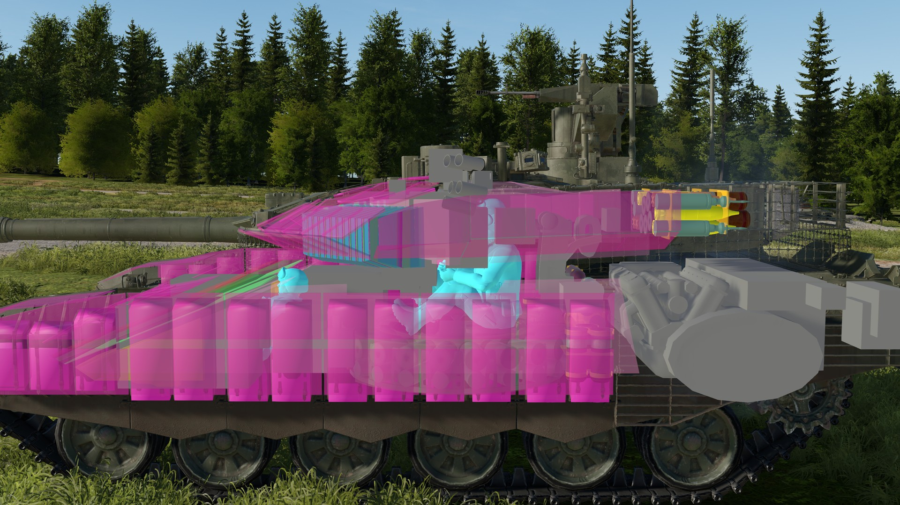
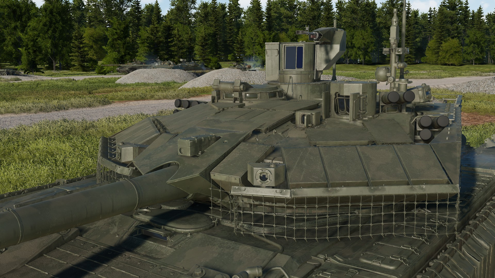
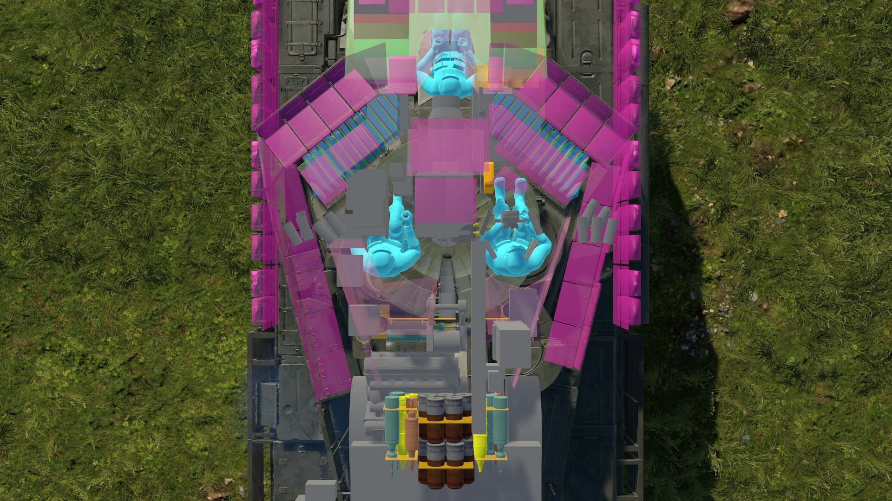
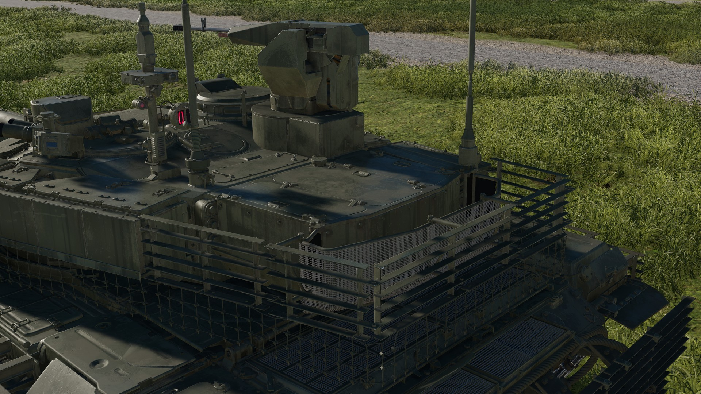

# The armour

How the T-90M's armour is put together, where the numbers come from and where it goes wrong. The short version is in
the [README](../README.md#armour-protection).

## War Thunder's shapes, my numbers

The armour pieces are cut from War Thunder's damage model of the T-90M, because it's a pretty good map of where every
plate, ERA box and screen sits on the real tank. None of War Thunder's armour values is used. Every thickness and
strength comes from the Russian sources further down, and where nothing was published, from the closest real
equivalent, marked as a guess in my notes.

In game it's ordinary GHPC armour, the same kind the vanilla tanks use and hit by the same rules. Under it the hull is
still the T-72's, which the real T-90's is too.

Inside it works like a vanilla tank. Crew, ammo and the carousel sit where they are in the real T-90M, and the crew
compartments are cut to the T-90M's own walls, so a round has to get through the armour before it counts as inside.
Drives, sights, the fire control, radio, the remote station and the smoke tubes are damageable modules wired into the
game's own systems, so knocking one out does what it does on any GHPC tank. The AI picks its ammo and shoots at the
vanilla tanks' pace, and the T-90M burns and cooks off like the T-72M1 next to it.

I shot it 552 times in game, at 47 spots all over the tank, next to a vanilla T-72M1 getting the same, and checked where
every round stopped.

  
  

*Left: the hit x-ray from the side, Relikt in pink, the crew light blue, the modules grey. Right: the turret front with
its Relikt and the net screens.*

## Where the design comes from

It's based on **real Russian documents I found online**:

- **Turret:** welded from rolled plates, as the T-90M's own technical description has it (posted on the "Одетые в
  броню" forum), with spall liners on the sides, roof and front plates. The cheek filling is the T-72B obr. 1989 / T-90
  package of reflecting plates, which andrei_bt's research on T-72 / T-90 filler packages says is still used on the
  T-90M, at the T-90A's figures because I found no T-90M figures I could trust.
- **Upper glacis:** the T-72B obr. 1989 / T-90 stack, layer by layer: 60 mm steel, rubber and steel with an air gap,
  60 mm steel, a 10 mm kevlar layer instead of the old anti-neutron lining, 50 mm steel at 68°. From Russian
  Wikipedia's «Т-90М» article and andrei_bt.
- **Hull:** 80 mm sides, 85 mm lower front plate, 40 mm rear, 20 mm belly, from Russian Wikipedia and Tankograd.
- **Relikt:** the maker's own protection figures (NII Stali), turned into GHPC armour the same way as the Kontakt-5 on
  my T-90A.
- **Where nothing could be found** (turret sides, roof and rear wall), the value comes from the T-90A or the T-72s.

The default preset is "game-scale", which keeps the T-90M in the right place next to GHPC's own tanks. `Armour preset`
= "source-only" gives the lower open-source figures instead: 575 / 750 on the turret and 500 / 650 on the glacis. Only
the strength changes, not the layout.

## How it compares

Line-of-sight protection straight from the front, in mm of steel, **without ERA**:

| | Turret cheeks (vs APFSDS / vs HEAT) | Upper glacis (vs APFSDS / vs HEAT) |
|---|---|---|
| **T-90M (this mod)** | **690 / 820** | **552 / 752** |
| [T-90A](https://github.com/marsattackk/GHPC-T90A) (my other mod) | 690 / 819 | 549 / 748 |
| [T-80UM2](https://github.com/marsattackk/GHPC-T80UM2) (my other mod) | 744 / 984 | 485 / 653 |
| T-80B (vanilla) | 595 / 669 | 485 / 602 |
| M1IP (vanilla) | 516 / 999 | 348 / 361 |

Median over a grid of straight-on shots. Both T-90s and the T-80UM2 were measured in game on their cheek block and
glacis. The vanilla tanks were read from their armour in the game's files over the whole cheek face, so their thin
edges pull their median down a bit.

The T-90M and T-90A rows are near enough the same because under the ERA it's the same turret and the same glacis.

## Relikt

Relikt adds about **250** against APFSDS and **650** against HEAT on the turret, **600** on the hull, wherever a box is
hit. It's in the rubber side screens as well.

A box only goes off for something that's worth it. Machine-gun and autocannon rounds up to 30 mm, fragments and spall
leave it whole, the same rule as Kontakt-5 on my T-90A. GHPC on its own sets ERA off on any hit, a PKT round
included. A box that has gone off is gone, so a second hit on the same spot only meets the armour behind it.

By default it goes with a blast, the plate round it sooted and the nets over it cut. With `ERA destruction effects` set
to false it still looks whole but doesn't protect anything any more.

## Screens and the bustle box

The rubber side screens work like the game's own rubber skirts, with Relikt in them, and the slats round the back like
its slat armour. The nets on the turret spoil a non-tandem HEAT grenade 55 % of the time and let the rest through
untouched, which is roughly what the people who make them claim against a PG-7. Tandem rounds go through both.

The **bustle box** on the turret rear is a compartment of its own. A round through its sides hits the stowed ammo in
there and nothing else, and the crew and the rest of the tank don't count it as inside. If it cooks off, the lids blow,
the fire goes up and out, and the tank keeps its engine.

  
  

*Left: the x-ray from above, the carousel under the turret and the racks. Right: the bustle box and its slat cage.*

## Test firing

Fired in game straight at the front (ERA on, turret straight and turned 17°):

| | T-90M |
|---|---|
| 3BM42 at the upper glacis | stopped in the glacis and its Relikt |
| 3BM42 at the turret cheek | stopped in the cheek filling |
| 3BK18M HEAT at the turret cheek | stopped by the Relikt |
| 9M119M1 Invar-M at the turret cheek | the precursor sets the Relikt off and the main charge stops at the inner wall, about 50 mm short |

## Weak spots

If you're fighting one, or trying to keep one alive, this is where it goes wrong. Straight from the front, from my test
firing (turret straight and turned 17°):

| Spot | What happens |
|---|---|
| Strip down the middle of the glacis (no Relikt on it) | a 3BM42 gets through and stops at the hull floor. An Invar-M reaches the cooling fan |
| Mantlet, next to the gun | an Invar-M coming in at an angle can get through into the turret |
| Gun mask round the barrel | the barrel itself stops what hits it |

From the side and above it's a T-72, same as my T-90A. The hull sides behind the screens are 80 mm.
