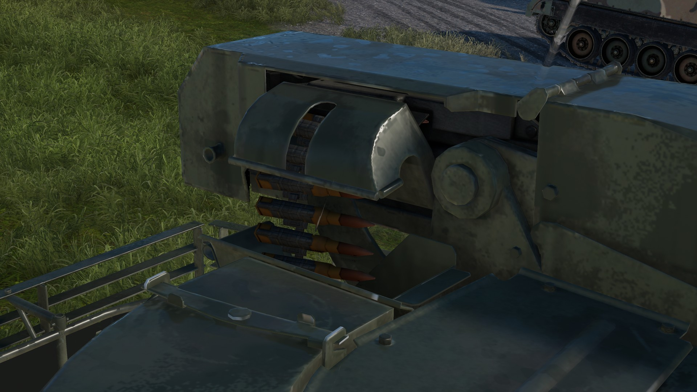
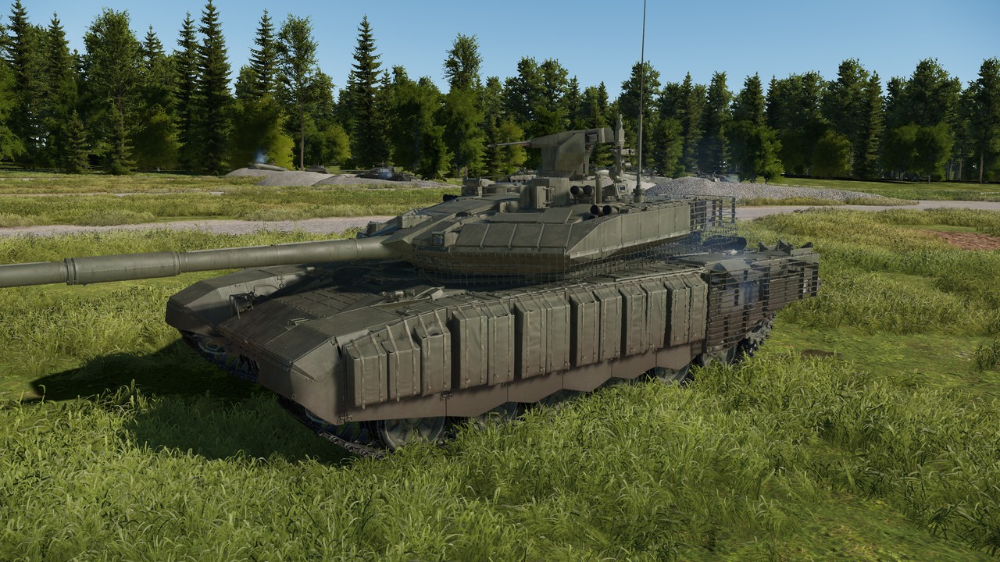
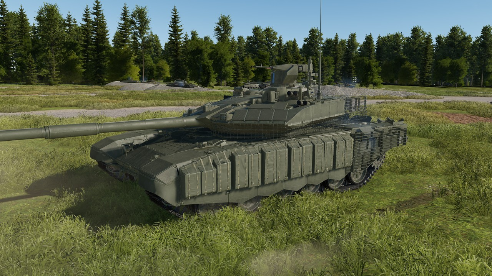

# The T-90M in detail

The bits that didn't fit in the [README](../README.md): the comparison with the T-90A, the sights, the Kord and the
ammo up close, the numbers, and where the mod isn't quite the real tank. The armour and TShU-1-2M have their own pages,
[armour.md](armour.md) and [screens.md](screens.md).

## From the T-90A to the T-90M

A lot of T-90Ms are rebuilt T-90As, so underneath it's the same tank as my other mod. Same hull, running gear,
autoloader and gearbox, still the T-72's 4.2 km/h reverse. What changed:

| | T-90A (my other mod) | T-90M (this one) |
|---|---|---|
| ERA | Kontakt-5, about +140 vs APFSDS / +550 vs HEAT | Relikt, about +250 / +650 (+600 on the hull), also in the rubber side screens |
| Other screens | none | nets on the turret, slats at the back |
| Turret | welded, every round inside the hull | the same welded front, plus an armoured bustle box on the rear with 10 rounds behind blow-off lids |
| Gunner's sight | 1G46 with the ESSA thermal on its own head, 1A45T fire control | Sosna-U, day and thermal in one head, Kalina fire control and a target tracker |
| Commander | TKN-4S day / night sight | PK PAN panorama, TV and thermal, can lay the gun and hand targets to the gunner |
| Remote Kord | on the cupola, 2 belts of 150, 625 rounds a minute | on top of the panorama, one belt of 300, 200 or 100 rounds a minute |
| Defensive aids | Shtora-1: IR jammer, laser warning, aerosol screens | TShU-1-2M: laser warning and aerosol screens, no jammer |
| Engine | V-92S2, 1000 hp | V-92S2F, 1130 hp |
| Turret traverse | 24°/s | 40°/s |
| Main gun ammo | 42 rounds | 40: 22 in the carousel, 8 in the hull, 10 in the bustle box |
| Rounds | 3BM42 / 3BM60, 3BK18M, 3OF26, 9M119M Invar (700 mm) | the same shells plus the 3OF82 Telnik, and the 9M119M1 Invar-M (850 mm) |

So it's better protected where the ERA, the screens and the bustle box come in, quicker onto a target off to the side,
and the commander can hunt on his own. The front armour under the ERA hasn't changed, though, and the Kord fires at a
third of the T-90A's rate or less.

GHPC has no T-72B, so the T-90M is built on the T-72M1 (running gear, hull internals, autoloader, diesel) and takes its
army, voices, sight sounds and HUD from the T-80B. Those borrowed parts, plus the T-64B's machine-gun station and the
M60A3 TTS thermal screen effect, are copied once from the game's own files at the main menu, so another mod freeing
those vanilla assets later doesn't break it.

## A bit of history

Uralvagonzavod's design bureau started on it in the early 2010s as "Proryv-3". It took what worked on the T-90AM and
its export version, the T-90MS ("Proryv-2"), and fixed what the army had found wrong with the older tanks. It was first
shown at Army-2018 and the first ones reached the army in spring 2020.

## The sights

**Sosna-U:** the day channel at 4x and 12x, with the reticle from the manual's figure. The thermal channel has three
fields (9 × 6.75°, 3 × 2.25° and 1.5 × 1.12° with the electronic zoom), rendered 768 x 576 across the 4:3 picture and
shown grey on a flat monitor. The grey comes from the Sosna-U's own figures. Laser rangefinder from 300 m to 10 km.
Line of sight -10° / +30°, stabilised on its own, and up to 7.5° ahead of the turret sideways.

**PK PAN:** the TV channel 7.4° and 2.5° wide in black and white, and the thermal in the same three fields as the
Sosna-U, with the same marks. Its own laser, 300 m to 7.5 km. It turns all round on the turret roof and looks from -15°
to +45°, and the Kord turns with it. Leave the panorama and the station holds its bearing on the turret, so it swings
round with the turret until you come back.

**ПДТ:** the gunner's back-up TV sight, left of the gun. It's laid along the bore, not on the computer's impact point,
so it gives no lead. -9° / +17°, a stadiametric scale, and the range set by hand.

**The tracker's ready frame** comes up when the target is big enough in the picture to lock, about 4 km for a T-72 in
the narrow thermal. Nobody publishes that figure, so it's my guess.

## The Kord

- A 6P49MT Kord, one belt of 300, three armour-piercing incendiary to one tracer. The belt's reloaded under armour,
  though the real box sits outside on the mount.
- 316° of traverse and -10° / +45°. The station turns at 45°/s and elevates at 10°/s.
- The 44° it can't fire through is over the gunner's sight head. The manual's figure gives the size of that gap but not
  where it is, so where it sits is my guess.
- Aimed only through the panorama, not from the commander's head view (the one with the binoculars).
- The drives, the panorama and the gun can each be knocked out.
- The belt feeds round by round as it fires. The spent cases go out forward on the right and lie on the tank until it
  tilts or brakes hard enough to shake them off. `Kord spent cases` turns them off.

## The ammo

- **22 in the autoloader's carousel** under the turret floor.
- **8 in the hull**, against the engine bulkhead, as the T-90M's manual has it: the charges in a rack on the floor, the
  shells in racks under the hull roof behind spall screens. Only six shells fit under the roof, so two lie in the floor
  rack, and how they're arranged there is my best guess.
- **10 in the bustle box** on the turret rear, behind blow-off lids. It's refilled only outside a fight, like on the
  real tank, and a round out of it takes 20 s.
- The T-72's middle fuel tank rack is gone on the real T-90M, so there's nothing stowed there.

The 3BM60 has its own longer rod and sabot, and the Invar-M is its own missile. They're made from the game's own round
models, so they don't look out of place next to the vanilla shells.

**The Telnik** is the 3OF26's shell with an air-burst fuse. The Kalina works out the flight time from the lased range as
the round goes into the breech, allowing for the muzzle standing a few metres ahead of the laser. Set short, it bursts
about 10 m in front of the target. Set over, the gun lays about 3 m high and the round bursts at the range. The fuse
spread is 0.05 s either way. That's the published figure, which I read as one standard deviation, so now and then a
round bursts well off. It throws 450 fragments in a cone 20° either side of its line. Under 300 m, or with no valid
range, it falls back to impact, and the vehicle menu shows what the round in the breech was set to.

## The Arena-M kit

KBM has the Arena-M on a T-90M in trials: the maker's own account is that the Arena is operational in Russia and was shown
at IDEX 2025 on this tank, and the T-90M has been seen with the new turret at its trials. I found no delivery paperwork,
so the kit is a trial fit, and the settings text says so. The model is War Thunder's T-90M with the Arena-M. Its turret
isn't shaped like the normal one, so the kit brings the reshaped parts and hides the normal ones they replace. A tank
without it is exactly the T-90M without a kit.

What a kit tank gets:

- **12 rounds in four launcher boxes** on the turret, six a side. The model has 13 launcher tubes, and the thirteenth, at
  the back in the middle, is left out.
- **Six radar panels** on the model, each watching an arc of the turret's circle. A destroyed panel blinds its arc, a
  destroyed launcher box loses its rounds without a cook-off, and the fire computer in the turret's rear box takes the whole
  system out when it goes.
- **Two rounds at each threat.** A round leaves its tube, climbs and turns toward the threat, and bursts over it with a cone
  of fragments pointed at it. The threat is rolled as a kill, as with the Drozd: destroyed, broken up, or it flies on.
  A missile, rocket or HEAT shell flying at 70 to 1000 m/s is tracked from about 130 m. A sabot round is faster than
  that and goes straight through.
- **The fragments are real.** They hit whatever stands in their cone, friend or foe, as with the Drozd's. KBM gives the
  danger zone for own infantry as 20 to 30 m.
- **Reloading** is the Drozd's option: a round a minute from the vehicle menu while the tank is nearly still, as many
  as you like. The crew's switch is in the same menu, with the Drozd's five minutes before it's ready again.
- **About 1.2 t more** and the turret's armour round the new parts, from the model's own damage model.
- **No bustle box.** The model has no stowage there and the computer sits in the turret's rear, so a kit tank has 30 rounds,
  22 in the carousel and 8 in the hull. The box, its lids and its blow-off go with it.

Who carries it is decided when the mission starts, because the game only says which tank is yours then: yours by `Arena-M kit
on my tank`, every other T-90M by a roll against `Arena-M kit share`. A tank you switch to later keeps what it was given. The
console says once a mission how it came out.

## The paint

  
  

Weathered by default and made for the T-90M's own shape: dust and mud heavier toward the ground, grime in the crevices,
streaks down the sides, rust running from the bolts and edges at the back, chipped edges. `Weathered paint` set to false
gives the clean factory finish on the right.

## Numbers

| | |
|---|---|
| Engine | V-92S2F, 1130 hp at 2000 rpm, T-72 gearbox |
| Mass | 51 t |
| Speed | 60 km/h forward, 4.2 km/h reverse (the real gearbox's reverse) |
| Turret traverse / gun elevation | 40°/s / 28°/s |
| Gun | 2A46M-5, -6°13′ / +13°47′ over the front, less depression over the engine deck |
| Autoloader | The game's own T-72M1 timing, about 7.2 s for every round |
| Main gun ammo | 40 rounds: 3BM60 or 3BM42, 3BK18M HEAT, 3OF26 HE-Frag, 3OF82 Telnik, 9M119M1 Invar-M |
| Coax PKTM | 2000 rounds (5 boxes of 400) |
| Remote Kord MT | 300 rounds, 200 / 100 rounds a minute |
| Smoke | 12 × 81 mm "Tucha", 3D17 aerosol grenades |

| Round | |
|---|---|
| 3BM60 "Svinets-2" (default) | 693 mm at the muzzle, 1660 m/s |
| 3BM42 "Mango" | as on the T-90A |
| 9M119M1 "Invar-M" | 850 mm, tandem warhead (sets off ERA first), arms at 100 m, out to 5000 m, guided along the gunner's sight line |
| 3OF82 "Telnik" | the 3OF26's shell with an air-burst fuse, 450 fragments |
| 3BK18M HEAT, 3OF26 HE-Frag | the game's own rounds |

## Where it isn't the real tank

Some of these are my choices against what the sources would give, and the rest are places where the sources ran out.

**Firepower**

- The round mix is mine, because nobody publishes one: 20 APFSDS, 8 HEAT, 4 HE, 4 Telnik and 4 Invar-M. The carousel
  holds 12 / 4 / 2 / 2 and two missiles, the hull 4 / 1 / 1 and two missiles, the bustle box 4 / 3 / 1 / 2 and no missile.
  Only the 40 = 22 + 8 + 10 is sourced.
- In the campaign the T-90M turns up half as often as my T-90A (0.25 against 0.5), after 2 missions, and the 3BM42 half as
  often as the 3BM60. Those are my settings.
- The 3BM60's 693 mm and the 3BM42's 578 mm are the maker's 300 and 230 mm at 60° at 2 km, doubled for the line of sight
  and carried back to the muzzle through the game's drag. The 3BM60's 4.5 kg is its core's, because the flight mass isn't
  published, and the 3BM42 flies on the game's 3BM32 drag.
- The Invar-M's 17.2 kg is Russian Wikipedia's figure. The exporter gives it only for the older 9M119M. It flies at one
  steady 294 m/s, 5 km in 17 s, because GHPC flies missiles at a constant speed, and it self-destructs just past 5 km, since
  the real time isn't published.
- The Telnik's burst 10 m short is the distance its table gives the fragment circle for, the 3 m over the target is my own
  number, and so are the fragments' drag and their 6 mm of penetration at 1200 m/s. Its charge is the game's 3OF26 cut to
  the Telnik's 3.0 kg of A-IX-2 against 3.4.
- The gun's elevation speed isn't published for the T-90M: 28°/s is worked out from a patent whose electric drive is 1.6
  times faster than the hydraulic one, at 45°/s. The autoloader keeps the game's T-72M1 timing, because no cycle time is
  published for the T-90M's either.
- The gun's depression at each turret angle is my own table, with the barrel kept clear of the hull. No source gives it.
- The turret's 40°/s is the T-90MS's, from the maker's table and brochure, as the T-90M's own isn't published.
- Restocking the carousel from the hull rack keeps the game's T-72M1 pace, 20 to 30 s a round. The T-72A manual loads
  the carousel at 11 to 14 s a round.
- The bustle box's lids blow off like the M1's; the manual describes hinged, bolted lids. The lids' thickness, the size
  of the fire and the restock time are my own.
- How the eight hull rounds sit and the tracker's lock distance are my guesses too.

**Sights**

- The Sosna-U's laser reaches 10 km and its line of sight +30°, its 2014 manual's figures for the sight in the T-72B3.
  The maker's T-90MS table gives 7500 m, and an older table +20°.
- The Sosna-U head's 7.5° of travel in traverse I read as 7.5° either side.
- Every PK PAN figure, the fields, laser, limits and speeds, comes from one 2011 table posted on a forum without its
  origin. It agrees with the Sosna-U's manual and a VOMZ patent where they overlap, but I couldn't trace it.
- The thermal pictures are clean, as on a flat monitor. The T-90M's own monitor isn't published, and the Sosna-U's
  manual describes a CRT on the T-72B3. The panorama's TV in black and white is my guess too.
- In Dubl the commander lays the main gun through the panorama's picture and lases with the panorama's own rangefinder.
  The sources say he can lay and fire the gun, not through which picture or with which laser.
- The gun is laid onto the point under the cross at the lased range, allowing for the sight head standing off the bore.
  The manual names no such correction, so that's my reading.
- The ПДТ shows 4 × 3°, its datasheet's 4° width on a 4:3 picture. The datasheet gives 2.55° for the height.
- The panorama's tracker works in its TV and thermal narrow fields, follows at 10°/s and keeps its lock while the Kord
  fires. None of that is published. `Target tracker from the day sight` goes past the real tracker, which works off the
  thermal picture only, so it's off by default.
- The gunner's laser window and periscope, and the ПДТ's eye in the roof block I take for it, sit where I placed them on
  the model.
- The warning page is my own layout, because the real one isn't published. The panorama's and the back-up sight's marks
  are borrowed from the Sosna-U or inferred.

**The Kord and TShU-1-2M**

- The Kord's belt reloads under armour, though the real box sits outside on the mount. The station's speeds are the
  panorama's, and its blind sector and the mouth of its case chute are guesses.
- TShU-1-2M has War Thunder's 5 tubes on the left and 7 on the right; the manual says 6 a side. What the T-90M's sources
  leave out is copied from the T-90A's Shtora-1: no automatic screen with a hatch open or for 15 s after your own shot, the
  tubes at 12° and the 3D17 cloud.

**The Arena-M kit**

- Real Arena-M figures are rare. Where the Arena-M has none I took the Arena-E's from KBM's page (70 to 700 m/s widened
  to the Arena-M's 1000, the 0.07 s reaction), then the old Arena's (ready again after 0.3 s, the cone of 35° between its
  25 to 40), then the Drozd's (a five minute warm-up, the kill chances, the fragments, the round's speed). Nobody publishes
  a warm-up for the Arena-M.
- KBM gives the Arena-E's detection as about 50 m. At 50 m a 1000 m/s shell is past the burst point before the reaction
  time and the round's flight are over, and even the Arena-E's own 700 m/s wouldn't work. So the radar tracks from 130 m,
  where the fastest threat can still be met. That figure is worked out, not published.
- The sectors of the four launcher boxes and the arcs of the six radar panels are my reading of where each sits on the
  turret and of «360° all round». No source gives them. The radar's bearing origin, on the turret's axis at the roof, is mine too.
- The burst height of 2 m, the 8 m from the radar it happens at and the 4 m its fragments reach are mine. The sources say
  a round turns toward the threat and fires a stream of heavy fragments at it, nothing more.
- Right rear holds six rounds because the tube at the back in the middle joined it, so that each side holds six as Janes says.
- The mass, 1150 kg, is the middle of KBM's 1000 to 1300 kg for the Arena-E. The weight of the extra armour isn't published.
- No bustle box and so 30 rounds is my reading: War Thunder's Arena-M has no stowage there and Janes puts the computer in the
  turret's rear.
- No hatch interlock, because none is published. The Drozd has one.
- The drones the Arena-M is advertised against aren't in the game, so nothing engages one.
- Only a trial fit has been shown on the T-90M. The turret's armour and the modules come from War Thunder's model of it.

**Armour**

- The armour presets are the T-90A's figures (game-scale: turret 690 / 820, glacis 550 / 750; source-only: 575 / 750 and
  500 / 650, without ERA), because I found no figures for the T-90M I could trust. Relikt's bonus on top is worked out
  from the maker's factor.
- The plate shapes are War Thunder's. None of its armour ratings is used, but where no source gives a thickness (the
  turret shell, the cupola ring, the driver's hatch, the bustle box) the plate is as thick as the model draws it.
- The cheek packages stand square to the cheek wall, as on my T-90A and in the section drawings of the T-72B / T-90
  turrets. No drawing of the T-90M's own turret is published.
- Relikt takes Kontakt-5's rule for what sets a box off, because nobody publishes Relikt's own.
- A set-off Relikt container is simply gone, because there's no model of a spent one, and the nets being cut over it is
  my guess.
- The nets spoil a HEAT grenade 55 % of the time, the middle of NII Stali's 0.5 to 0.6 for its own net of the same kind
  against a PG-7. That isn't named as the T-90M's net, and it says nothing about tank shells or missiles.
- The three internal fuel tanks are in the hit report only and start no fire of their own, like the game's own tanks'
  fuel tanks, and the periscopes aren't hit zones.

**Sources**

These are the ones the numbers on this page and in the code lean on.

- «Описание танка Т-90М», the T-90M's technical description, posted on the «Одетые в броню» forum:
  [odetievbrony.ru](https://odetievbrony.ru/viewtopic.php?id=1649). The stowage, the coax and the Kord, the Kord's firing
  angles, TShU-1-2M's heads, the bustle box and the mass.
- Russian Wikipedia, [Т-90М](https://ru.wikipedia.org/wiki/%D0%A2-90%D0%9C) (the history) and
  [2А46](https://ru.wikipedia.org/wiki/2А46) (the Invar-M's mass).
- Uralvagonzavod's T-90MS table, from the
  [Internet Archive](https://web.archive.org/web/20170127204849/http://uralvagonzavod.ru/product/70/57), and its brochure
  pages on Gur Khan's blog, [«Т-90МС «ТАГИЛ»: Система управления огнем»](http://gurkhan.blogspot.com/2011/09/90_23.html).
- В. Калмыков, А. Мирошниченко, «Многоканальный прицел наводчика «Сосна-У»» (ВУНЦ, 2014):
  [PDF](https://suveren.com.ua/attachments/article/163/SOSNA_U.pdf).
- «ТТХ комбинированного прицела наводчика ПН «Сосна-У» и панорамного прицела командира ПК ПАН «Соколиный глаз»», a 2011
  table on the [otvaga2004 forum](http://otvaga2004.mybb.ru/viewtopic.php?id=140&p=8) (every PK PAN figure).
- andrei_bt, [«Прицел дублер телевизионный ПДТ»](https://andrei-bt.livejournal.com/601336.html) (Пеленг's datasheet) and
  [«Танковый осколочно-пучковый снаряд "Тельник"»](https://andrei-bt.livejournal.com/63588.html) (the Telnik's exhibition
  data).
- [«Автомат сопровождения цели в танке Т-72Б3»](https://vk.com/@ovbron-avtomat-soprovozhdeniya-celi-v-tanke-t-72b3), from
  the T-72B3's technical description (the tracker).
- «Танк Т-72А. Техническое описание и инструкция по эксплуатации», book 1, 1986:
  [PDF](https://www.military-references.com/wp-content/uploads/books/tanks/ussr/t-72/%D0%A2%D0%B0%D0%BD%D0%BA_%D0%A2-72%D0%90_%D0%A2%D0%B5%D1%85%D0%BD%D0%B8%D1%87%D0%B5%D1%81%D0%BA%D0%BE%D0%B5_%D0%BE%D0%BF%D0%B8%D1%81%D0%B0%D0%BD%D0%B8%D0%B5_%D0%B8_%D0%B8%D0%BD%D1%81%D1%82%D1%80%D1%83%D0%BA%D1%86%D0%B8%D1%8F_%D0%BF%D0%BE_%D1%8D%D0%BA%D1%81%D0%BF%D0%BB%D1%83%D0%B0%D1%82%D0%B0%D1%86%D0%B8%D0%B8_%D0%9A%D0%BD%D0%B8%D0%B3%D0%B0_1_1986.pdf)
  (the gun's angles, the gearing and reverse, the carousel's loading pace).
- Patent [RU 2421679](https://patents.google.com/patent/RU2421679C1/ru) (the gun's elevation speed).
- vpk.name, [«Основной боевой танк Т-90 "Владимир"»](https://vpk.name/library/f/tank-t-90.html) (the engine's 2000 rpm,
  the 3BM60's core).
- NIMI's Army-2019 figures for the 3VBM23 and the 3BM42 on the Glavcom blog,
  [«Технологии в танкостроении. БПС»](https://glavcom.blogspot.com/2020/04/apfsdsbps3bm42mango3bm60svinec.html), and the
  [3VBM17 spec sheet](https://lugansk-ukraine.livejournal.com/68280.html).
- btvt.info, [«Комплекс управляемого вооружения 9К119М «Рефлекс-М»»](https://btvt.info/3attackdefensemobility/tyr125.htm)
  (the Invar-M).
- НВО, [«Антиквариату место не в танке, а в музее»](https://nvo.ng.ru/armament/2011-05-20/12_anikvariat.html) (the
  3OF26's filler).
- [«12,7 мм пулемет "КОРД"»](https://vimpel-v.com/small_arms/kkp/4098-127-mm-pulemet-kord.html) (the Kord's belt and its
  spent cases).
- NII Stali's [Relikt page](https://web.archive.org/web/20150402101852/http://www.niistali.ru/products/military/relict/relikt_t72m_t90sm_bmpt/)
  (archived 2015) and Союзмаш,
  [«НИИ стали» разработал невидимую защиту от гранат](https://soyuzmash.ru/news/companies-news/nii-stali-razrabotal-nevidimuyu-zashchitu-ot-granat/)
  (the nets).
- Rossiyskaya Gazeta on the Arena-M:
  [«Раскрыты особенности работы комплекса активной защиты "Арена-М"»](https://web.archive.org/web/2021/https://rg.ru/2021/09/20/raskryty-osobennosti-raboty-kompleksa-aktivnoj-zashchity-arena-m.html)
  (2021: the rounds, two at a threat, −6° to +20°, all round), and
  [the 2023 patent piece](https://web.archive.org/web/2023/https://rg.ru/2023/10/26/zapatentovan-obrazec-t-72b3m-s-ustanovlennym-kompleksom-zashchity-arena-m.html)
  and [the 2024 qualification piece](https://web.archive.org/web/2024/https://rg.ru/2024/02/15/kompleks-aktivnoj-zashchity-arena-m-predstavili-na-kvalifikacionnye-ispytaniia.html)
  (12 shafts). [Lenta, 2021](https://web.archive.org/web/2021/https://lenta.ru/news/2021/09/20/arena/) (two rounds a threat).
- Janes, [«IDEX 2025: KBM confirms Arena APS operational in Russia, looks to export»](https://www.janes.com/osint-insights/defence-news/land/idex-2025-kbm-confirms-arena-aps-operation-in-russia-looks-to-export)
  (the layout on the T-90M, the radar and the computer, the crew's switch).
- [KBM's Arena-E page](https://web.archive.org/web/2023/https://www.kbm.ru/ru/production/saz/38.print) (detection, speeds,
  reaction time, danger zone, mass, power), Russian Wikipedia,
  [«Арена (активная защита)»](https://ru.wikipedia.org/wiki/Арена_(активная_защита)) (the old Arena's ready time), and
  btvt.info, [«Комплекс активной защиты танка "Арена"»](https://btvt.info/3attackdefensemobility/kaz_arena.htm) (the cone).
- Militarnyi, [«Russia builds T-90M with active protection system»](https://militarnyi.com/en/news/russia-builds-t-90m-with-active-protection-system/)
  (the radar panels, the smoke launchers moved), and www1.ru,
  [«Прорывные танки Т-90М усовершенствовали новой защитой Арена-М»](https://www1.ru/news/2025/09/09/proryvnye-tanki-t-90m-usoversenstvovali-teloxranitelem-arena-m-protiv-bpla.html)
  (up to 1000 m/s).
- In English: Coclé and others, «QWIP compact thermal imager: Catherine-XP and its evolutions» (Thales, SPIE 2007):
  [PDF](https://www.thermoview.ru/pdf/QWIP_paper_Orlando.pdf).

## What it shares with my T-90A

I built the T-90M after the [T-90A](https://github.com/marsattackk/GHPC-T90A), on the same groundwork. Everything I
worked out there carries over: how the armour's put together, the ERA that doesn't go off for a PKT round, the Invar's
tandem precursor, the Kord's belt feed and spent cases, the paint, the T-80B's crew voices, and a fix on one goes into
the other. What's new is what's new on the real tank: the bustle box as its own compartment, the panorama with the Kord
on it, Relikt and the nets, TShU-1-2M, the tracker and the Telnik. It's still its own mod and neither needs the other.

My [T-80UM2](https://github.com/marsattackk/GHPC-T80UM2) came after both, on the same groundwork: a T-80U with
Kontakt-5 and the Drozd active protection, the T-90A's rival from the T-80 side rather than a step towards the T-90M.
