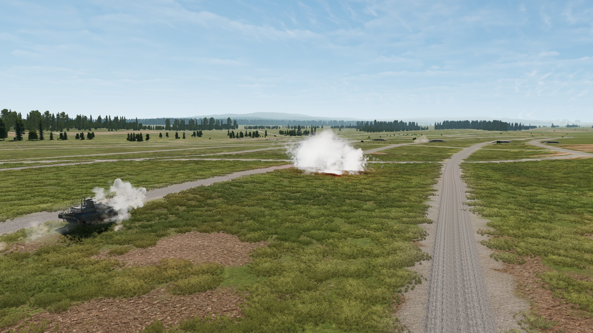
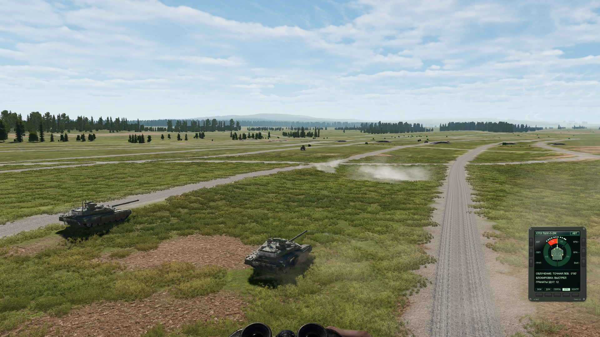

# TShU-1-2M

The T-90M's soft-kill system: a laser warning and aerosol screens. It's the screen half of the T-90A's Shtora-1, and
like the real T-90M it has no IR jammer, so the red lamps either side of the gun are gone. What it does in a fight is in
the [README](../README.md#tshu-1-2m). This is how each part works and what stops it.

  
  

*Left: a laser from the front, and the T-90M puts a 3D17 screen between itself and the shooter. Right: the warning
page, showing where the laser came from.*

## The laser warning

Four heads on the turret watch for lasers, and they turn with it. Two precise ones cover 45° either side of where the
turret points. Two coarse ones on the sides take the rest of the circle. They see from 5° below to 25° above the
turret's level, and a laser from higher than that isn't seen at all.

Directions are always relative to the turret, not the hull.

## The page

On a warning, the commander's screen page comes up bottom right with a tone. It shows the four sectors, which way the
laser came from and what the system did about it. In the thermal sight, the ПДТ and the panorama it sits larger in the
black bar to the right of the picture (on a widescreen monitor). In the day sight it shrinks under the picture.

The page is my own take. The real tank has it on the commander's display, and I couldn't find a picture of that page
anywhere, so the layout is inferred from what the system has to show.

`TShU-1-2M page always on screen` keeps it up the whole time you're in the T-90M, with the grenades left and the mode
between warnings. With `TShU-1-2M warning page` off you get the tone and nothing on screen.

## The screens

From the front, in automatic mode, it fires a 3D17 grenade from the tube pointing closest to the laser. The grenade
goes out 50-80 m and bursts after a second. The cloud builds up in about 3 s and hangs for about 20 s. It blocks lasers
and eyes but not thermal sights, because the real one is made for visible light and near infrared.

From the side or rear you only get the warning, since a coarse head can't tell where to aim a screen. For 20 s after
such a warning the vehicle menu has **Turn to Laser**, which swings the turret round until a precise head sees the
laser. If they're still lasing you, the screen goes up from there.

## What it does to the shooter

An AI tank whose laser is blocked loses its rangefinder and judges the range by eye, give or take 10 %. Against APFSDS
at 1600 m that barely matters, because the round's flat enough to hit anyway. It matters more for slower rounds like
HEAT, and the cloud hides you while it stands.

AI T-90Ms have the system too. Lase one from the front and it screens itself. Lase it from the side and its turret
comes round towards you.

## When it won't fire

The automatic screen holds off:

- with a hatch open
- for 15 s after your own main gun shot, because the real system holds the screens after you fire

Neither the automatic screen nor the menu fires one when there's already a cloud standing on that line, when you're out
of grenades, or when the tubes are knocked out. Aerosol Screen from the menu ignores the hatch and the 15 s, though.

## Using it

**Vehicle menu > TShU-1-2M** has Aerosol Screen (fires one where the gun points, grenades left in brackets), Screen
Mode (AUTO, or SEMI where you get the warning and fire the screen yourself) and Turn to Laser after a side or rear
warning. The smoke key (default G) still fires the tubes the game's way, with 3D17s in them.

The weapon info bottom left gets a `TShU-1-2M:` line with the mode, auto or semi-auto. Under it a `TShU-1-2M screen:`
line says "ready" with the grenades left, or why it's held: hatch open, your own shot with the seconds left, no
grenades. For a few seconds after a warning that brought no screen it says why, a cloud already there for example.

`TShU-1-2M` set to false takes the whole system out, and the tubes fire the game's ordinary smoke salvo. The other
`TShU-1-2M` settings in the [README](../README.md#settings) tone down each part.
